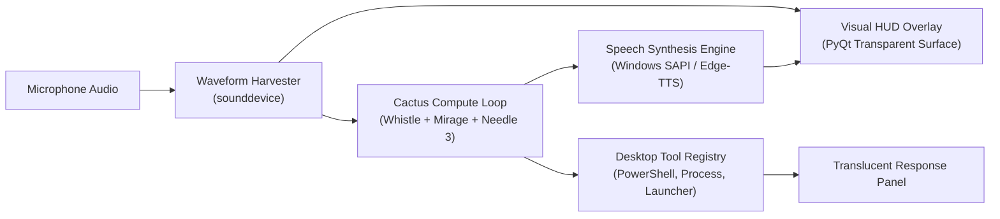

# Cactus Desktop Operator

<div align="center">


**An offline desktop automation assistant featuring an audio-reactive visual interface, local compute pipelines, and native Windows speech synthesis.**

</div>

---

## Capabilities

### 1. Audio-Reactive Interface
* **Idle State:** Smooth cyclic gradient transitions across indigo, violet, and cyan hues.
* **Active Listening:** Audio-reactive fluid waveform visualization reacting directly to microphone input amplitudes.
* **Processing:** Orbital node animations indicating reasoning and tool execution state.
* **Speech Feedback:** Luminescence aura modulation synchronized with voice synthesis output.

### 2. Speech Synthesis
Integrated native Windows SAPI and Edge-TTS engines for spoken task status confirmations and execution summaries.

### 3. Glassmorphic State Card
Translucent HUD overlay that dynamically expands adjacent to the interface core, displaying real-time command input, tool status, and execution output.

### 4. Window Management
Frameless, transparent, always-on-top window implementation with multi-monitor drag repositioning.

---

## Architecture



---

## Getting Started

### Prerequisites
* Operating System: Windows 10 or Windows 11
* Python 3.10 or higher
* Audio input and output devices configured

### Installation
```powershell
# Clone repository
git clone https://github.com/NoorulAhameddev/cactus-desktop-operator.git
cd cactus-desktop-operator

# Install dependencies
pip install -r requirements.txt
```

### Execution

* **Interactive Terminal Mode:**
  ```powershell
  .\run_siri.ps1
  ```
* **Background Silent Mode:**
  Execute `run_siri_silent.vbs` to launch the HUD directly onto the desktop without maintaining an open terminal window.
* **Compact Bubble Interface:**
  ```powershell
  .\run_bubble.ps1
  ```

---

## Voice Commands Reference

Supported spoken commands include:
* "Open Chrome"
* "Check if git is installed"
* "Check if node is installed"
* "Restart proxy.mjs"
* "Run dir in PowerShell"
* "Read the last 10 lines of README.md"

---

## Project Structure

```
cactus-desktop-operator/
├── siri_orb.py           # Core visual HUD overlay and audio visualizer
├── bubble_ui.py          # Alternative compact interface layout
├── desktop_agent.py      # Multi-turn desktop agent execution loop
├── grounder.py           # Window coordinate and control resolver
├── tools.py              # Windows process and system tools
├── main.py               # Headless CLI entry point
├── run_siri.ps1          # Interactive PowerShell launcher
├── run_siri_silent.vbs   # Silent VBScript background launcher
├── requirements.txt      # Python dependencies
└── README.md             # Technical documentation
```

---

## License

This project is licensed under the [MIT License](LICENSE).
