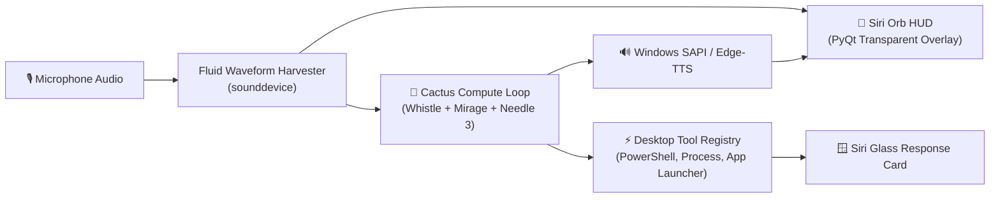

# 🔮 Cactus Multimodal Siri Desktop Orb

<div align="center">


**An ultra-compact, 100% offline desktop automation assistant styled after Apple Siri, powered by Cactus Compute (Whistle + Mirage + Needle 3) and Windows Native SAPI Voice Synthesis.**

</div>

---

## ✨ Features

### 1. 🌈 Iconic Glowing Siri Orb
* **Idle:** Gentle breathing rhythm with neon cyan, hot magenta, electric violet, and indigo gradients.
* **Listening:** Audio-reactive swelling fluid waveforms reacting dynamically to your microphone's live input level.
* **Thinking:** Orbiting glowing nodes swirling fluidly around the center core.
* **Speaking:** Pulsing warm aura while speaking back to you.

### 2. 🗣️ Speaks Back (Text-to-Speech)
Siri speaks back naturally with real-time text-to-speech (*"Opening Chrome"*, *"Git is installed on your computer"*, *"Process restarted"*, etc.).

### 3. 🪟 Siri Translucent Response Card
A dark-glass floating popover slides out next to the orb displaying what was asked, tool execution progress, and clean outputs.

### 4. 🖱️ Always-on-Top & Draggable
Click and drag the orb anywhere on your screens. It floats smoothly above all open application windows.

---

## 🏗️ System Architecture



---

## 🚀 Quick Start

### 1. Prerequisites
- **OS:** Windows 10 / 11
- **Python:** Python 3.10+
- Working microphone and speakers

### 2. Installation
```powershell
# Clone the repository
git clone https://github.com/NoorulAhameddev/cactus-desktop-operator.git
cd cactus-desktop-operator

# Install dependencies
pip install -r requirements.txt
```

### 3. Running the Assistant

* **Interactive Mode (with terminal logs):**
  ```powershell
  .\run_siri.ps1
  ```
* **Silent Mode (Orb only, no terminal window):**
  Double-click `run_siri_silent.vbs` to float the Siri orb directly on your desktop.
* **Alternative Bubble HUD:**
  ```powershell
  .\run_bubble.ps1
  ```

---

## 🎙️ Natural Voice Commands

Speak naturally into your microphone:
* *"Hey Siri, open Chrome"*
* *"Siri, check if git is installed"*
* *"Hey Siri, check if node is installed"*
* *"Siri, restart proxy.mjs"*
* *"Siri, run dir in PowerShell"*
* *"Read the last 10 lines of README.md"*

---

## 📁 Repository Structure

```
cactus-desktop-operator/
├── siri_orb.py           # Core Siri Glowing Orb HUD and audio visualizer
├── bubble_ui.py          # Alternative translucent bubble interface
├── desktop_agent.py      # Multimodal agent execution loop
├── grounder.py           # Desktop coordinate and window resolver
├── tools.py              # Windows desktop automation tools
├── main.py               # Main CLI execution entry point
├── run_siri.ps1          # Interactive PowerShell launcher
├── run_siri_silent.vbs   # Silent VBScript background launcher
├── requirements.txt      # Python dependencies
└── README.md             # Documentation
```

---

## 📝 License

This project is licensed under the [MIT License](LICENSE).
